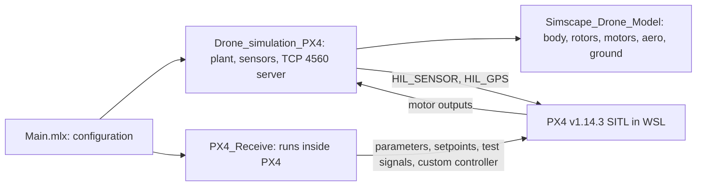

# Drone simulation and PX4 SITL

A configurable MATLAB/Simulink/Simscape quadrotor simulation flown by the real **PX4 v1.14.3 flight stack** in Software-in-the-Loop (SITL). **Start with [Main.mlx](Main.mlx).**

| What you can do | Section |
| --- | --- |
| Configure the drone (frame, motors, propellers, payloads) and simulate it | [Drone model](#drone-model-and-configuration) |
| Fly a square, circle or figure-8 and score how well it follows the path | [Missions](#missions-square-circle-figure-8) |
| Tune all of PX4's PID loops automatically (RMSE score or PX4-guide rules) | [Automatic PID tuning](#automatic-pid-tuning) |
| Replace PX4's PID loops by your own controller (LQR with integral action) | [Custom controller](#custom-controller-lqr-with-integral-action) |

The repository models a generic quadcopter, the **unit drone**: 1.0 kg without payload, a cylindrical body, 200 mm arms, 2212 / 920 KV motors and 10×4.5″ propellers (see [Drone model](#drone-model-and-configuration)).

Results are in [docs/](docs). The results there and the result numbers in this README were obtained with an earlier vehicle configuration, not with the unit drone; they show what the tools do, and are not reproduced by the current parameters. Simulation results are not flight approval; nothing here is applied to a real aircraft automatically.

## Setup

| Component | Version / requirement |
| --- | --- |
| Host | Windows with WSL2 (Ubuntu 22.04), PX4 v1.14.3 built in WSL |
| MATLAB | R2025b with Simulink, the UAV Toolbox Support Package for PX4 Autopilots (PX4 Host Target) and its code-generation products |
| Plant | Simscape and Simscape Multibody |
| Magnetometer model | Aerospace Toolbox (`wrldmagm`, World Magnetic Model) |
| Custom controller design | Simulink Control Design and Control System Toolbox |

Complete the PX4 support package's hardware setup on each PC (PX4 source and build folder, host/WSL network). Keep the whole repository together, including the STEP files and the BEMT `.mat` files in `Propeller/`: they are model inputs.

**Network:** PX4 in WSL connects to the plant's simulator server on the Windows host, TCP port **4560** (through the WSL virtual adapter), and MATLAB monitors PX4 over XCP on TCP 17725. A Windows firewall rule must allow the WSL adapter to reach port 4560. If MATLAB reports "XCP connect failed" and the plant never gets a connection, check that rule first; bind it to the interface alias `vEthernet (WSL (Hyper-V firewall))`, because the adapter's ID changes after a reboot.

## How a simulation runs



- **Plant (`Drone_simulation_PX4`)**: the Simscape Multibody drone with motor and propeller models, plus simulated sensors (IMU, magnetometer, barometer, GNSS). It is the simulator PX4 connects to (lockstep, PX4 waits for the plant).
- **PX4 SITL**: the real PX4 firmware (estimator EKF2, PID loops, mixer) running in WSL.
- **`PX4_Receive`**: a Simulink model built and run *inside* PX4 as an app. It writes the PID gains as PX4 parameters at startup, publishes the mission or tuning setpoints, switches PX4 to OFFBOARD and arms it, and contains the custom controller. MATLAB monitors it in external mode.
- **Order:** the plant starts first, then `PX4_Receive` (MATLAB "Build, load and run"). The runners below do this, handle PX4's startup dialog (`px4_ack_popup`) and stop everything afterwards (`stop_px4_run`). Use one MATLAB session; a second plant would compete for port 4560.

**Project layout:**

| Folder | Contents |
| --- | --- |
| root | `Main.mlx`, `initialization.m`, the runners `run_mission`, `run_px4_guide_tuning`, `run_px4_tuning`, `linearize_drone`, and the Simulink model `PX4_Receive.slx` |
| `parameters/` | component catalogues and the parameter builders (vehicle, plant, Simscape, PX4, magnetic field) |
| `flight/` | mission plans and trajectories, mission scoring, comparison and plots |
| `flight/auto_tuning/` | PID tuning: test schedule, scoring, search logic and session files |
| `controller/` | custom controller: parameters, control law, design |
| `px4/` | running PX4: startup dialog, stop and cleanup, `PX4_Receive` set-up, clock alignment |
| `Drone Models/` | plant models; `Propeller/`, `step files/`, `Pictures/` hold their input data |
| `tests/`, `docs/` | offline tests; results and notes |

`project_paths` adds all of them to the MATLAB path (`initialization.m` and the runners call it). Every function has help text: `help run_mission`.

**Main.mlx sections:** (1) initialization and hardware selection, (2) initial conditions `IC`, (3) flight-controller profile (`PX4TuneChoice`: `Default`, `HandTuned_RealDrone`, `Simulated-PID-Gains` or `LQI`, see `px4_tuning_parameters`; `LQI` switches the custom controller on; `check_gain_validity` warns when the selected gains were tuned or designed for a setup whose mass, inertia or maximum thrust differs by more than 10 % from the current one), (4) the tuning menu and mission examples. Run them from the top; `initialization.m` clears the workspace.

## Drone model and configuration

**What it does:** builds the physical drone from component catalogues and simulates it in Simscape Multibody.

**How to use:** pick the components in Main.mlx's first section (`DroneChoice`, `MotorChoice`, `PropellerChoice`, `PlantChoice`, payloads). Each catalogue function lists its options when called without input, for example `motor_parameters()`.

**The unit drone** (`drone_parameters("UnitDrone")`): a generic quadcopter with round numbers. Body: solid cylinder, radius 50 mm, height 100 mm, 640 g. Arms: four, 200 mm long, 25 g each. With four 2212 / 920 KV motors (56 g each) and four 10×4.5″ propellers (9 g each) it weighs 1.000 kg without payload. The optional top payload `Top_Cylinder_100g` is a 100 g cylinder with the body's radius. Mass, centre of mass and inertia are calculated from this geometry and passed to the Simulink models through `SimParams` and `SimscapeParams`; the inertia is symmetric in roll and pitch.

**How it works:**
- `load_configuration` collects the selected entries of the catalogues (`drone_parameters`, `motor_parameters`, `propeller_parameters`, `plant_parameters`, `top_payload_parameters`, `bottom_payload_parameters`) and derives propulsion data. Thrust and torque coefficients come from BEMT data (`Propeller/*.mat`).
- `assemble_vehicle` computes mass, centre of mass, inertia and rotor geometry; `build_simulation_parameters`, `build_simscape_parameters` and `build_px4_parameters` turn that into the plant parameters and the PX4 airframe settings.
- **Propellers:** the 8" STEP files are stand-in geometry (no 10" CAD model exists); each solid is centred on its spin axis (`PropellerCADCentring*` in `build_simscape_parameters.m`). Without that, the 1.37 mm centre-of-mass offset of the CCW file makes every rotor vibrate at its rotation frequency. The remaining imbalance is negligible, smaller than a real balanced propeller would cause.
- **Motors:** the motor-speed loop is a plant-internal PI controller with a near-ideal response, not validated against measured motor data.
- **Home position and magnetometer:** the home position is set once, `SimParams.HomeLLA` in `build_simulation_parameters.m`. The GNSS reports positions relative to it, and the magnetometer field is the World Magnetic Model at that position and date (`earth_magnetic_field`). PX4's EKF looks up the declination for the reported position, so the two agree wherever home is placed; the heading estimate is within about 0.4° of the truth (the gap between PX4 1.14.3's built-in WMM-2020 table and WMM2025). Before 11 November 2026 the magnetometer used a fixed default field and the heading estimate was up to 10° off.

## Missions: square, circle, figure-8

**What it does:** flies a reference path in SITL with PX4's PID loops (any gain set) or with the custom controller, and scores the flight on the plant's physical truth.

**How to use:**
```matlab
plan = flight_plan("figure8");          % "square", "circle" or "figure8"
plan.Size = 4;                          % square side / circle diameter / figure-8 length [m] (width = Size/2)
plan.Altitude = 5;                      % [m]
plan.SettleTime = 10; plan.LegTime = 5; plan.DwellTime = 0; plan.FinalHoverTime = 18;   % one lap = 4*(LegTime+DwellTime)
plan.VelocityFeedforward = true;        % also send the analytic reference velocity (feedforward)
plan.HeadingAlongPath = true;           % circle / figure-8: nose follows the direction of travel

A = run_mission(plan, Gains="Default", Repeats=3);
B = run_mission(plan, Gains="HandTuned_RealDrone", Repeats=3);
C = run_mission(plan, Gains="Simulated-PID-Gains", Repeats=3);   % or Gains=TuningSession.BestGains
D = run_mission(plan, Gains="LQI");                      % custom controller instead of PX4's PID loops
T = compare_missions([A B C D]);                         % table + figures
```

`run_mission` saves every flight (raw data, `score.mat`, detailed plots) in `FlightValidation_<time>/` (git-ignored). `compare_missions` writes a table and report figures: bar charts and paths, each as a colour-blind-safe version (`_CB`, viridis colours plus line styles) and a standard red/green version (`_RG`), PDF and PNG.

**How it works:**
- **Reference:** `flight_plan` holds the settings; `flight_trajectory` evaluates the path at any time (also inside PX4_Receive): takeoff, settling, the path with a smooth start and stop, then a final hover. The figure-8 is a lemniscate of Gerono (x = a·sin φ, y = a/2·sin 2φ). With `VelocityFeedforward` the analytic velocity and yaw rate are sent too; give PX4 and the custom controller the same setting when comparing them.
- **Scoring (`score_mission`)**, on the path itself (lower is better): tracking error RMS (3-D, against the moving reference), distance from the path RMS (timing-independent), lag, altitude error, heading error, settling time after the lap, maximum tilt, motor-command rate (smoothness) and a composite score. Repeat flights agree within about 1 %.
- **Speed:** a 76 s figure-8 takes about 6 minutes (about 3 min PX4 build, 2.5 min flying). Automated runs switch the 9 scopes in `PX4_Receive` off in memory: in external mode each scope streams its data from PX4 on every step, and without them a flight runs twice as fast with identical logged data. Interactive runs from Main.mlx keep the scopes.

## Automatic PID tuning

**What it does:** tunes all 23 PID gains of PX4's cascade (rates, attitude, velocity, position) automatically, starting from PX4's Default gains, within a wall-time budget.

**How to use:** select the **Default** profile in Main.mlx, then
```matlab
TuningSession = run_px4_guide_tuning("all", Method="rmse", MaxHours=22);   % recommended
TuningSession = run_px4_guide_tuning("all");                               % PX4 tuning-guide rules
TuningSession = run_px4_guide_tuning("all", Mode="validate");              % fly the current gains once per group
PX4Tune = TuningSession.BestGains;                                         % use the result
```
or run Main.mlx's tuning section and choose **18** (RMSE) or **17** (guide) in the menu.

**How it works:**
- **Flights:** loop groups are tuned in order rates → attitude → velocity → position. Each flight takes off to 10 m, waits until the drone is settled, then gives every axis of the group ten alternating step commands (roll, pitch, yaw, or horizontal and vertical), so one takeoff serves the whole group. Each group starts with 3 baseline flights; their spread is the repeat noise. A final check flies every group once with the result.
- **RMSE method (`px4_rmse_axis`):** each axis searches its gains (rate: K, D, I; attitude: P; velocity: P, I, D; position: P) by stepping them ×1.3 up or down, refined to ×1.14, and keeps a change only if the **RMSE score** J = RMSE/A + 0.30·max|e|/A + 0.25·overshoot (A = step amplitude) improves by more than twice the repeat noise. Responses that oscillate are rejected. After each group a **robustness probe** flies every loop gain ×1.3; an axis that oscillates or goes unstable there is backed off ×0.85, which leaves a gain margin of at least 1.3.
- **Guide method (`px4_guide_axis`):** follows the PX4 tuning guide: clear oscillation, balance P and D, raise gains until oscillation or overshoot sets in and back off.
- **Why RMSE is the default:** the RMSE run from Default (69 flights, 15 h, with the earlier vehicle configuration) gave the best gains of every set tested. On the figure-8 (3 flights each): path deviation 4.9 cm, against 7.1 cm for the hand-tuned and 24 cm for the Default gains; composite score 31 vs 51 and 99; 7× smoother motors than hand-tuned. The guide rules keep the outer loops at Default because Default already overshoots by more than 1 %. Those gains are stored as the profile `"Simulated-PID-Gains"`; results in [docs/results_20261116](docs/results_20261116/README.md).
- **Safety and validity:** every flight is checked for complete steps, altitude, body-rate, recovery and motor-saturation limits (`score_px4_tuning_candidate`). An execution failure (for example the known, rare startup stall around 16 s) is retried once and never scored as a controller result.
- **Results:** one folder per session in `TuningSessions/` (git-ignored) with `session.mat`, the flight table (`TuningSession.Flights`, including every flight's gains and RMSE score), the decision log and the gain-evolution figures `GainEvolution_CB/_RG` (every gain over the flight numbers, relative to Default; `plot_gain_evolution`). Reload with `L = load(fullfile(folder,'session.mat')); TuningSession = L.Session;`.

**Full description:** [docs/AUTO_TUNING.md](docs/AUTO_TUNING.md) (all options, the score, the search, outputs, time and limitations).

**Single-loop sessions** (`run_px4_tuning`, menu 1-16) tune one loop per flight with the earlier joint finite-difference search; they are kept for verification of a single loop and are slower for full tuning.

## Custom controller (LQR with integral action)

**What it does:** flies the drone with a 12-state discrete LQR with integral action (LQI) running inside PX4, instead of PX4's PID loops.

**How to use:** select the profile **LQI** in Main.mlx's `PX4TuneChoice` drop-down; this sets `CUSTOM_CONTROLLER = 1`. From code: `run_mission(plan, Gains="LQI")` (or `Controller="lqr"` for the version without integral action). To redesign after changing the vehicle:
```matlab
[~,~,~,~,result] = linearize_drone;                          % hover linearisation (no PX4 needed)
D = design_custom_controller(result);                        % design + checks, see D.Checks
design_custom_controller(result, WriteParameters=true);      % writes custom_controller_parameters.m
```

**How it works:**
- **In PX4:** the "Custom Controller (LQR)" subsystem in `PX4_Receive` reads PX4's state estimate, computes the motor commands (`lqr_hover_control`) and publishes them directly (`actuator_motors`) in OFFBOARD actuator mode, in which PX4 1.14.3 turns its own rate, attitude and position controllers off.
- **Design:** state [N E D, vN vE vD, yaw pitch roll, p q r] at 100 Hz; Bryson weights (0.5 m, 1 m/s, 10°, 30°/s), R = 1000. Integral action adds integrators of the N, E, D and yaw errors. Checked on the full plant with motor dynamics: stable with up to two samples of extra delay; phase margin at the motors 34° (LQI) and 39° (LQR) without extra delay, 25° and 27° with two samples.
- **Integral action in flight:** starts after the takeoff climb, freezes while a motor saturates, is capped, and is kept in the North-East-Down frame so it stays correct while the heading turns. It removes constant offsets (hover thrust, wind, yaw torque) within about 5 s.
- **Result on the figure-8** (3 flights, earlier vehicle configuration): tracking error 19.2 cm, altitude error 4.3 cm, lag 0.04 s and the smoothest motors of all sets (plain LQR, one flight: 28.2 and 8.0 cm). The RMSE-tuned PID still tracks better (11.5 cm); the LQR's yaw axis is its slowest (heading error about 8°).
- **Gains in this repository:** the stored LQI gains were designed for the earlier vehicle configuration, so `check_gain_validity` warns when they are used with the unit drone. Redesign them with the three lines above before flying the unit drone with the LQI.
- Details: [CUSTOM_CONTROLLER.md](CUSTOM_CONTROLLER.md).


## Tests

`tests/test_guide_tuner.m` (tuner logic, RMSE search and full dry runs with synthetic flights), `tests/test_joint_optimizer.m` and `flight/auto_tuning/test_*.m` run offline; no simulation is started.

## Troubleshooting

- **PX4 stops at 0 s / XCP connect failed:** the firewall rule for TCP 4560 on the WSL adapter (see Setup).
- **Model Recovery dialog after an interrupted run:** delete the `*.autosave` files in the project.
- **A run stops early around 16 s:** a rare PX4 startup stall of unknown cause; the runners retry once.
- **Wrong functions or models:** use only one checkout on the MATLAB path and close models from other copies; the runners check this.
- **Stopping a run:** `stop_px4_run()`. It also ends processes named `px4` in WSL, so run one experiment at a time.

## Source control

Commit source, live scripts, models and their input assets. Generated results stay out of Git (`.gitignore`): `TuningSessions/`, `FlightValidation_*/`, `linearization_results/`, `reports/`, build and cache folders, and the built `PX4_Receive` binary.
